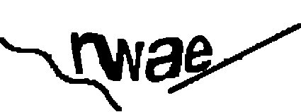

# Rastreamento Correios
Aplicação de linha de comando que faz consultas ao portal dos Correios, permitindo rastrear códigos de encomendas.  
O CAPTCHA é resolvido automaticamente e os códigos de rastreio informados são validados, todos os dados de rastreamento são extraídos do portal
e devolvidos em um JSON estruturado, que inclui o histórico completo de eventos de cada objeto.<br><br>
Aplicação feita para o desafio técnico da NetSpeed

## Sumário

- [Como executar](#como-executar)
- [Exemplo de saída](#exemplo-de-saída)
- [Tecnologias](#tecnologias)
- [Arquitetura](#arquitetura)
- [Estratégia de automação](#estratégia-de-automação)
- [Resolução do CAPTCHA](#resolução-do-captcha)
- [Estrutura do JSON](#estrutura-do-json)
- [Tratamento de erros](#tratamento-de-erros)
- [Testes e CI](#testes-e-ci)
- [Limitações conhecidas](#limitações-conhecidas)
- [Melhorias futuras](#melhorias-futuras)

---

## Como executar

### Pré-requisitos

- Windows (ver [Limitações](#limitações-conhecidas))
- .NET 8 SDK
- Visual C++ Redistributable 2019 x64 (usado pelo Leptonica/Tesseract)

### Instalação

```bash
git clone https://github.com/Santiago22-py/Automacao-Correios.git
cd Automacao-Correios
dotnet build
powershell -ExecutionPolicy Bypass -File src/RastreamentoCorreios/bin/Debug/net8.0/playwright.ps1 install chromium
```

O último comando ignora as restrições do Windows para executar o script do Playwright que baixa e configura o navegador Chromium necessário para a automação.

### Uso

```bash
dotnet run --project src/RastreamentoCorreios -- <Codigo de Rastreio>
dotnet run --project src/RastreamentoCorreios -- NN437873753BR --saida resultado.json
```

| Opção | Descrição | Padrão |
|---|---|---|
| `--saida <arquivo>` | grava o JSON também em arquivo | — |
| `--tentativas <n>` | máximo de tentativas de CAPTCHA | 14 |
| `--intervalo <ms>` | intervalo entre tentativas | 5000 |
| `--timeout <ms>` | tempo máximo de cada ação no navegador | 30000 |
| `--visivel` | abre o navegador visível (depuração) | desligado |

O JSON vai para a saída padrão (stdout); o log das tentativas vai para a saída de erro (stderr).

| Código de saída | Significado |
|---|---|
| 0 | sucesso |
| 1 | argumentos inválidos |
| 2 | falha no rastreamento (código inválido, objeto não encontrado, portal indisponível, CAPTCHA esgotado, resposta inesperada) |
| 3 | falha ao gravar o arquivo de saída |

Exemplo de log:

```
[15:34:55] tentativa 1/14: OCR leu 'nv6y', portal respondeu 'Captcha inválido'
[15:35:00] tentativa 2/14: OCR leu 'dlzza', aceito. Consultas enviadas: 2
```

---

## Exemplo de saída

```JSON
{
  "codigoObjeto": "NN437873753BR",
  "tipoPostal": "ETQ LOG PACKET STANDARD",
  "previsaoEntrega": "2026-09-03",
  "eventos": [
    {
      "codigo": "BDE",
      "tipo": "01",
      "status": "Objeto entregue ao destinatário",
      "descricao": "Queremos te ouvir! Responda a uma pesquisa rápida e nos ajude a melhorar a sua experiência: https://survey3.medallia.com/?correios-nps-sms-sro&obj=NN437873753BR",
      "dataHora": "2026-08-31T16:04:26-03:00",
      "local": {
        "tipo": "Unidade de Distribuição",
        "nome": null,
        "cidade": "Sao Jose do Rio Preto",
        "uf": null
      },
      "origem": null,
      "destino": null
    },
    {
      "codigo": "OEC",
      "tipo": "01",
      "status": "Objeto saiu para entrega ao destinatário",
      "descricao": "É preciso ter alguém no endereço para receber o carteiro",
      "dataHora": "2026-08-31T09:22:35-03:00",
      "local": {
        "tipo": "Unidade de Distribuição",
        "nome": null,
        "cidade": "Sao Jose do Rio Preto",
        "uf": null
      },
      "origem": null,
      "destino": null
    }
  ]
}
```
Clique [aqui](resultado.json) para ver um arquivo completo


---

## Tecnologias

| Tecnologia | Uso | Por quê |
|---|---|---|
| C# / .NET 8 | aplicação de console | preferência declarada no enunciado, linguagem robusta e que oferece tipagem estática nativamente |
| Microsoft.Playwright 1.63.0 | automação do navegador e interceptação da rede | Playwright é moderno e desenvolvido e mantido pela Microsoft, permite controlar o navegador de forma confiável, capturar a imagem do CAPTCHA e interceptar a resposta JSON. Preferível ao CefSharp aqui por ser mais adequado a automação web, ter diversos recursos nativos e por trazer interceptação de rede e espera automática prontas, que no CefSharp exigiriam implementação própria |
| Microsoft.ML.OnnxRuntime 1.31.0 | executa o modelo de reconhecimento do CAPTCHA | Permite executar localmente o modelo ONNX e com bom desempenho, se faz necessário para usar o modelo do DdddOcr, que foi feito primariamente para ser usado em Python, nativamente em C#|
| Modelo `common_old.onnx` do [ddddocr](https://github.com/sml2h3/ddddocr) (MIT) | rede neural treinada em CAPTCHAs | Utilizado no lugar do Tesseract por ser especializado em reconhecimento de CAPTCHA, mostrou um desempenho bem superior |
| Tesseract 5.2.0 (Leptonica) | leitura de PNG/pixels; OCR alternativo | wrapper .NET mais usado do Tesseract; o Leptonica embutido permitiu ler e escrever pixels sem outra biblioteca de imagem |
| System.Text.Json | leitura da resposta do portal e geração da saída | Biblioteca nativa do .NET para serialização e desserialização JSON, cortando a necessidade de dependências extras |
| xUnit + GitHub Actions | testes automatizados e CI | Usados para os testes automatizados, o xUnit permite validar as regras e transformações da aplicação de forma unitária, enquanto o GitHub actions executa os testes automaticamente a cada PR e Merge |

### Tecnologias Descartadas
SixLabors.ImageSharp: A versão mais recente exige licença, e as 2.x e 3.x possuem vulnerabilidades conhecidas  
OpenCV: Pesaria demais o projeto, considerando para o que era necessário  
DdddOcr em python: Exigiria um script separado em Python, além de precisar de Python instalado na máquina, foi utilizado apenas seu modelo  

---

## Arquitetura

```
src/RastreamentoCorreios/
├── Program.cs                 composição: escolhe o solver, lê argumentos, traduz exceções em código de saída
├── Argumentos.cs              linha de comando
├── Rastreador.cs              orquestra: valida -> abre o portal -> retentativas do CAPTCHA -> mapeia
├── CodigoRastreamento.cs      validação local (formato + dígito verificador S10)
├── Navegacao/PortalCorreios.cs        tudo que é Playwright
├── Captcha/ICaptchaSolver.cs          contrato do solver
├── Captcha/OnnxCaptchaSolver.cs       solver padrão
├── Captcha/TesseractCaptchaSolver.cs  solver alternativo
├── Captcha/FiltrosImagem.cs           pré-processamento comum
├── Extracao/RastreamentoMapper.cs     JSON do portal → modelo de saída
├── Modelos/Portal/                    formato do portal
├── Modelos/Rastreamento.cs            formato de saída
├── Erros/Excecoes.cs                  exceções do domínio
└── Saida/JsonSaida.cs                 serialização
tools/CaptchaLab/              coleta de amostras, avaliador offline, consulta manual, teste do mapeador
tests/RastreamentoCorreios.Tests/
amostras/                      CAPTCHAs rotulados, respostas reais do portal, log de medições
```

Interface única (ICaptchaSolver) serve como ponto central de substituição, inclusive se mostrou útil quando o solver foi trocado de Tesseract para ONNX, mudando apenas uma linha no Program.cs.  
Dois conjuntos de modelos, portal e saída, assim se o portal mudar, será necessário adaptar somente o mapeador, sem detalhes espalhados por todo o código.  
Evitei usar injeção de dependências e camadas genéricas pois isso acabaria aumentando a complexidade de desenvolvimento e manutenção do projeto sem ganho que justificasse.

---

## Estratégia de automação

1. A aplicação abre o portal, preenche o código no campo ```#objeto``` e captura o CAPTCHA diretamente com um screenshot do elemento ```#captcha_image```. A imagem não é baixada novamente pela URL, pois isso criaria um novo desafio na sessão PHP e faria com que a imagem resolvida não correspondesse ao desafio exibido.  
2. O screenshot é processado pelo solver de CAPTCHA, e o resultado é preenchido no campo ```#captcha```. Em seguida, a aplicação clica em ```#b-pesquisar``` e aguarda, por meio de ```RunAndWaitForResponseAsync```, a resposta JSON de ```resultado.php```, que é usada como fonte dos dados de rastreamento. Essa abordagem é mais confiável do que ler o HTML, pois os eventos exibidos na página são montados pelo navegador a partir desse mesmo JSON.  
3. Após cada consulta, o próprio portal troca o CAPTCHA por meio da função ```refreshCaptcha``` do ```index.js```. A automação aguarda explicitamente o ```src``` da imagem mudar e a nova imagem terminar de carregar, usando ```WaitForFunctionAsync``` com JavaScript executado na página, antes de iniciar uma nova tentativa.  
4. As esperas são baseadas nos eventos relevantes, carregamento da imagem e resposta da rede, em vez de pausas fixas com ```sleep``` ou da condição genérica ```NetworkIdle```. Isso torna o fluxo mais previsível e evita tanto esperas desnecessárias quanto a continuação da execução antes de o portal estar pronto. O navegador utiliza ```DeviceScaleFactor = 1``` para que os screenshots do CAPTCHA tenham sempre a mesma escala e quantidade de pixels, mantendo consistente o processamento da imagem. 


### Como os elementos foram localizados

| Elemento | Seletor | Uso |
|---|---|---|
| Campo do código | `#objeto` | preenchido com o código validado |
| Imagem do CAPTCHA | `#captcha_image` | screenshot; `src` monitorado para detectar a troca |
| Campo do CAPTCHA | `#captcha` | preenchido com o texto reconhecido |
| Botão recarregar | `#captcha_refresh_btn` | nova imagem quando a leitura tem formato inválido |
| Botão consultar | `#b-pesquisar` | dispara o fetch para `resultado.php` |

Aqui a identificação foi relativamente simples, eu abri a DevTools pelo Google Chrome e investiguei a aba de network, além de ler o index.js do portal

---

## Resolução do CAPTCHA

Para decidir a melhor estratégia de resolução do CAPTCHA, eu primeiro investiguei um pouco.  
Gerei pouco mais de 30 imagens (via script e manualmente) do CAPTCHA para procurar padrões entre elas, com isso eu percebi que as imagens sempre tinham entre 
4 a 6 caracteres, todos minúsculos (apesar da validação ser case-insensitive), podendo ou não ter números, também percebi que certas letras não apareceram nas amostras como i, j, o, q, x e números como 0 e 1, provavelmente pra evitar confusão em quem está digitando.  
No mais, os ruídos sempre eram os mesmos, diversos pontinhos em formato de + espalhados pela imagem, além de linhas finas e grossas cortando os caracteres.

### Pré-processamento

| Etapa | O que faz | Por quê |
|---|---|---|
| Escala de cinza + Otsu | binariza com limiar calculado pelo histograma da imagem |Simplifica a imagem para separar o primeiro plano do fundo sem depender de um limiar fixo, que poderia não funcionar igualmente bem em todos os CAPTCHAs. |
| Remoção de componentes pequenos (< 150 px) | apaga os pontos "+" | Remove ruídos isolados e marcas pequenas que poderiam ser interpretados pelo modelo como parte dos caracteres. |
| Abertura morfológica (janela 5×5) | apaga linhas de 1–2 px | Reduz as linhas finas de interferência presentes no CAPTCHA, preservando, na medida do possível, as regiões maiores correspondentes aos caracteres. |
| Remoção de componentes pequenos (de novo) | apaga fragmentos soltos pela abertura | Limpa os resíduos gerados pela operação morfológica e entrega ao modelo uma imagem com menos elementos irrelevantes. |


| Antes | Depois |
| :---: | :---: |
|  |  |


### Reconhecimento

O reconhecimento principal utiliza o modelo ```common_old.onnx```, do projeto [ddddocr](https://github.com/sml2h3/ddddocr), uma rede neural convolucional cuja saída é decodificada utilizando CTC. Antes da inferência, a imagem do CAPTCHA é redimensionada para 64 pixels de altura, mantendo o padrão esperado pelo modelo. A decodificação é restrita à lista de caracteres permitidos e o resultado passa por uma validação de formato, entre 4 e 6 caracteres e somente símbolos válidos, antes de ser enviado ao portal. Quando a leitura é inválida, a aplicação troca a imagem e tenta novamente sem consumir uma consulta.

### Evolução medida

Amostra offline: 14 CAPTCHAs reais rotulados manualmente (`amostras/captcha/`), avaliados com `dotnet run --project tools/CaptchaLab -- avaliar [tesseract]`.

| Abordagem | Acertos exatos |
|---|---|
| Tesseract + Despeckle do Leptonica | 0/14 |
| Tesseract + Otsu | 0/14 |
| Tesseract + filtros + `tessdata_best` + whitelist | 2/14 |
| ddddocr (ONNX) sem pré-processamento | 3/14 |
| **ONNX + filtros (solução final)** | **7/14** |

### Taxa no portal

Medida com o fluxo completo (`amostras/medicoes.log` e execuções manuais), solver ONNX:

| Métrica | Valor |
|---|---|
| Execuções | 7 (todas bem-sucedidas) |
| Consultas enviadas | 11 |
| Aceitas | 7 (64% por consulta) |
| Tentativas por execução | média 1,6; máximo 4 |

Os resultados devem ser interpretados com cautela, pois a amostra é pequena e, portanto, possui um intervalo de confiança amplo. Embora a taxa de aceitação por consulta tenha sido de 64%, a métrica mais relevante para a aplicação é a taxa de sucesso por execução, já que existem retentativas limitadas: no fluxo medido, todas as 7 execuções foram concluídas com sucesso, com média de 1,6 tentativa. Essa taxa é crítica porque o portal pode bloquear novas requisições após poucas requisições em sequência, como referência, o Tesseract teve apenas 1 aceitação em 8 consultas no portal, resultado inferior ao solver ONNX utilizado na solução final.

---

## Estrutura do JSON


A saída mantém os mesmos nomes de campo do exemplo do enunciado: ```status```, ```descricao```, ```dataHora```, ```local```, ```origem``` e ```destino```, para facilitar a leitura e a comparação dos resultados. A unidade do portal é representada como um objeto com ```tipo```, ```nome```, ```cidade``` e ```uf```, em vez de ser reduzida a um texto. Em eventos de transferência, identificados pela presença de ```unidadeDestino```, ```origem``` e ```destino``` são preenchidos e local fica como ```null```; nos demais eventos, a unidade é mapeada para local.

A data e hora são combinadas com o fuso informado pelo portal (```America/Sao_Paulo```), preservando uma representação temporal completa. Valores vazios (```""```) são convertidos para ```null```, e espaços não separáveis são normalizados para evitar diferenças artificiais no JSON. Os campos ```codigo``` e ```tipo``` do evento são mantidos sem interpretação adicional, enquanto campos sem significado confirmado, como ```situacao``` e ```finalizador```, foram deixados de fora da saída.

| Campo de saída | Origem no portal |
|---|---|
| `status` | `descricao` |
| `descricao` | `detalhe` |
| `dataHora` | `dtHrCriado.date` + `dtHrCriado.timezone` |
| `local` | `unidade` (quando não há `unidadeDestino`) |
| `origem` / `destino` | `unidade` / `unidadeDestino` |

---

## Tratamento de erros

| Situação | Como é detectada | Resultado |
|---|---|---|
| Código inválido | regex + dígito verificador S10, antes de abrir o navegador | `CodigoInvalidoException` |
| Objeto não encontrado | portal responde erro diferente de "Captcha inválido" (para código inexistente: "Período inválido") | `ObjetoNaoEncontradoException` |
| CAPTCHA não reconhecido | "Captcha inválido" até o limite de tentativas | `CaptchaEsgotadoException` |
| Limite de requisições | resposta HTML em vez de JSON | `PortalIndisponivelException` (sem insistir) |
| Timeout / falha de navegação | `TimeoutException` / `PlaywrightException` | `PortalIndisponivelException` |
| Formato da resposta mudou | campos ausentes, JSON inválido, data em outro formato | `RespostaInesperadaException` |

O tratamento de erros prioriza validar o código antes de acessar o portal, evitando navegação e requisições desnecessárias para entradas inválidas. As exceções são capturadas apenas quando correspondem a situações específicas, inclusive com filtros (```catch ... when```), e a exceção original é preservada ao ser relançada para não perder o contexto do erro. Quando o portal indica limite de requisições ou retorna HTML em vez do JSON esperado, a aplicação não insiste e sinaliza a indisponibilidade imediatamente. Cada tentativa de resolução do CAPTCHA é registrada no ```stderr```, permitindo acompanhar o comportamento do fluxo sem misturar logs com o JSON produzido na saída padrão.

---

## Testes e CI

```powershell
dotnet test
```

O projeto possui 34 testes automatizados que cobrem a validação dos códigos de rastreamento, o mapeamento de respostas reais do portal, a validação do formato reconhecido do CAPTCHA, o processamento dos argumentos e uma regressão do solver, que deve manter pelo menos 7 acertos em 14 amostras offline. O acesso ao portal não é testado automaticamente, pois é lento, não determinístico e geraria carga desnecessária em um site de terceiros; esse fluxo foi medido separadamente com execuções manuais. A integração contínua é executada pelo GitHub Actions em ```windows-latest``` a cada push na ```main``` e em pull requests, executando ```dotnet test```.

---

## Limitações conhecidas

* __Taxa do CAPTCHA medida com amostra pequena__ : os resultados são baseados em poucas amostras e execuções, portanto podem não representar todos os desafios do portal
* __Limite de requisições do portal__: requisições em sequência podem provocar bloqueio após poucas tentativas, por isso a aplicação limita as retentativas e evita insistir quando identifica esse comportamento.
* __Windows apenas__: o processamento de imagem depende dos binários nativos do Leptonica distribuídos no projeto, atualmente preparados para Windows.
* __Um código por execução__: o fluxo atual recebe e processa um único código de rastreamento por execução, mantendo a implementação simples e controlada.
* __Interpretação de “Período inválido”__: essa resposta é tratada como objeto não encontrado, embora essa relação tenha sido inferida a partir do comportamento observado e não esteja documentada pelo portal.
* __Dependência da estrutura atual do portal__: a automação depende dos seletores, do fluxo de navegação e do formato JSON atualmente utilizados pelo site; alterações nesses elementos podem exigir ajustes no código.


---

## Melhorias futuras


* __Suporte a vários códigos por execução__: utilizar o endpoint rastroMulti.php, que permite consultar até 20 códigos com um único CAPTCHA, reduzindo o número de interações com o portal.
* __Ajuste fino do modelo de CAPTCHA__: treinar ou calibrar o modelo com uma base maior de CAPTCHAs do Securimage, previamente rotulados, para melhorar a taxa de reconhecimento em desafios reais.
* __Backoff automático__: implementar espera progressiva quando o portal limitar requisições, reduzindo a frequência das tentativas e evitando novos bloqueios.
* __Suporte multiplataforma__: substituir a dependência da leitura de PNG fornecida pelo Leptonica por uma alternativa compatível com Windows, Linux e macOS.


---

## Créditos

Modelo de reconhecimento de CAPTCHA: [ddddocr](https://github.com/sml2h3/ddddocr), licença MIT
(ver `src/RastreamentoCorreios/onnx/LICENSE-ddddocr.txt`).
